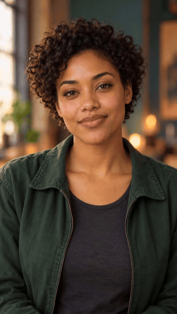
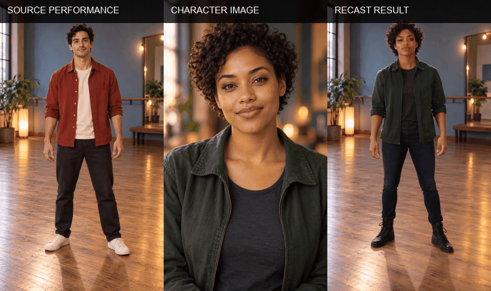

# Genjutsu

**Recast the performer in a short video with Seedance 2.5 or Wan 3.0.** Review the generated take, then export a local MP4 with the source soundtrack restored.

Genjutsu is a local-first workspace: source media is previewed and retained on your device. Both model choices share the same Muapi preparation stages for depth, environment, character, and prompt references. Choose **Genjutsu** for Seedance Motion Control or **Genjutsu Lite** for Wan 3.0.

  

## Sample avatar animation

<p align="center">
  <a href="docs/media/avatar-sample.mp4"></a>
  <br />
  <sub>Fictional character animation · 5 sec · 720p · Start frame: <a href="docs/media/avatar-sample.png">PNG</a> · Full clip: <a href="docs/media/avatar-sample.mp4">MP4</a></sub>
</p>

This is an example character clip. Genjutsu takes a source video and one or more character images as its inputs.

## Subject replacement sample

<p align="center">
  <a href="docs/media/recast-sample.mp4"></a>
  <br />
  <sub>Source clip: <a href="docs/media/source-performer.mp4">MP4</a> · Source start frame: <a href="docs/media/source-performer.png">PNG</a> · Character reference: <a href="docs/media/avatar-sample.png">PNG</a> · Recast result: <a href="docs/media/recast-sample.mp4">MP4</a></sub>
</p>

The source performer and character are fictional generated examples. These sample assets demonstrate the workflow and are not renders from either model option.

## How it works

1. **Choose the inputs.** Add a 4–15 second source clip and up to eight character images.
2. **Review the direction.** Choose motion transfer or object swap, set the output ratio and duration, and add an optional creative brief.
3. **Prepare references.** Depth Anything extracts a depth video. Gemini Video Vision analyzes motion and selects environment frames. Nano Banana 2 Edit cleans those frames, GPT Image 2 builds character sheets, and Gemini 2.5 Flash writes a model-specific prompt.
4. **Choose the render model.** Genjutsu sends the prepared references to Seedance 2.5 Omni Reference, the final render model used by Muapi's Seedance Motion Control flow. Genjutsu Lite sends the same prepared references to Wan 3.0 Reference to Video. Both choices use the same API key and Muapi submit-and-poll flow.
5. **Save the MP4.** The app downloads the result and restores the source soundtrack locally when one is present.

Seedance 2.5 accepts 4–30 second output durations and up to 30 final image references; Genjutsu limits character uploads to eight and adds environment plates from the source. Genjutsu Lite requires the source depth video and output duration to fit within Wan 3.0's 30-second combined limit and supports at most 10 final image references. Wan 3.0 may not reproduce the source performance frame for frame.

## Requirements

- Python 3.10+
- FFmpeg and `ffprobe` on your `PATH`
- An API key and available generation credits

Install FFmpeg with your system's package manager, then confirm both executables are available from a new terminal.

<details>
<summary>Install FFmpeg</summary>

```bash
# macOS with Homebrew
brew install ffmpeg

# Debian or Ubuntu
sudo apt install ffmpeg
```
</details>

## Run locally

```bash
git clone https://github.com/Anil-matcha/open-genjutsu.git
cd open-genjutsu
python3 -m venv .venv
source .venv/bin/activate
pip install -r requirements.txt
python -m uvicorn app:app --host 127.0.0.1 --port 8770
```

On Windows PowerShell, activate with `.venv\Scripts\Activate.ps1`.

Open <http://127.0.0.1:8770>, enter your API key, choose the source clip and character image, and upload them. The key stays in page memory and is forwarded by the local app with each request.

## Media limits

| Input | Supported formats | Limit |
| --- | --- | --- |
| Source video | MP4, MOV | 4–15 seconds; 50 MB |
| Character references | JPEG, PNG, WebP | Up to 8 images; 10 MB each |

The source must be readable by FFmpeg. Genjutsu Lite's output duration is capped so the source depth video and generated video together stay within 30 seconds. Genjutsu allows 4–30 second output. The app checks the source duration before upload.

## Privacy and local files

- The API key is held in page memory and is not written to disk or application logs.
- The source video is uploaded for recasting and kept locally under `runtime/assets/` for previews and soundtrack restoration.
- Character images are uploaded for the recast request and previewed in the browser.
- Generated exports are written under `runtime/exports/`.
- Use **Clear local files** when finished, or remove `runtime/` after stopping the server.
- The server binds to `127.0.0.1`. Keep it there; this app has no authentication for public hosting.
- Uploaded media is subject to the generation API's storage and retention terms.

Keep the server process and browser tab open while a job runs. Request state is held in memory and does not survive a server restart.

Use only source footage and likeness references you have permission to process and share. Review the result before publishing it.

## API adapter

The local FastAPI adapter uses these requests:

| Purpose | Request |
| --- | --- |
| Upload source, character images, and generated contact sheets/frames | `POST /api/v1/upload_file` |
| Generate depth video | `POST /api/v1/depth-anything` with `video_url` |
| Analyze video and write prompt | `POST /api/v1/gemini-video-vision`, then `POST /api/v1/gemini-2-5-flash` with the prompt contact sheet |
| Prepare image references | `POST /api/v1/nano-banana-2-edit` for environment plates and `POST /api/v1/gpt-image-2-image-to-image` for character sheets |
| Generate with Genjutsu | `POST /api/v1/seedance-2.5-omni-reference` with character/environment `images_list`, depth video in `videos_list`, prompt, resolution, aspect ratio, and duration |
| Generate with Genjutsu Lite | `POST /api/v1/wan3.0-reference-to-video` with character/environment `images_list`, depth video in `videos_list`, prompt, resolution, aspect ratio, duration, and `enable_audio: false` |
| Check each model stage | `GET /api/v1/predictions/{request_id}/result` |

All Muapi calls use the same API key entered in the app. Generated audio is disabled for Wan; the local exporter restores the source soundtrack after either render. Each image, video-analysis, and video-generation stage may use account credits.

The local app restores source audio after generation with FFmpeg. Replace the adapter calls in `app.py` to connect a different service with the same submit-and-poll pattern.

## Troubleshooting

| Issue | What to check |
| --- | --- |
| FFmpeg is not ready | Install FFmpeg, open a new terminal, and confirm `ffmpeg -version` and `ffprobe -version` work. |
| Upload is rejected | Check format, size, duration, API key, and account balance. |
| A request times out | Resume status checks or inspect request history before submitting again. |
| Source audio is missing | Confirm the source file still exists under `runtime/assets/` and FFmpeg can read its audio codec. |
| Job state is missing | The app process may have restarted. Start a new session and upload the media again. |

## Project layout

```text
app.py              Local FastAPI server and API adapter
static/index.html   Workflow interface
static/app.js       Upload, polling, review, and export flow
static/styles.css   Responsive studio interface
runtime/assets/     Temporary local source copies (ignored by Git)
runtime/exports/    Local exports (ignored by Git)
```

## License

Genjutsu is licensed under the MIT License. See [LICENSE](LICENSE).
